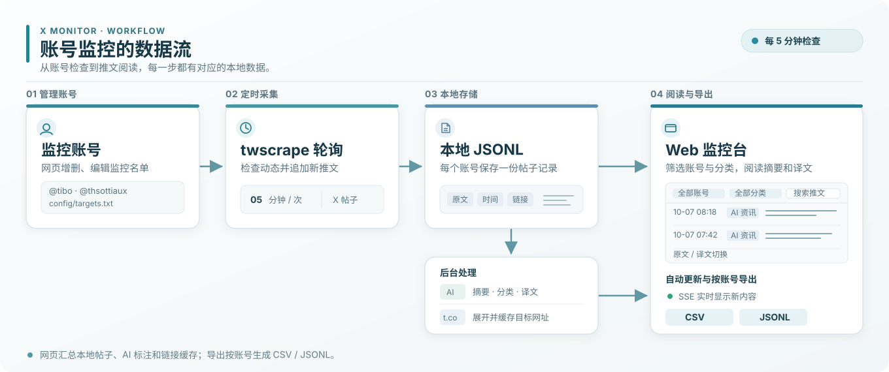
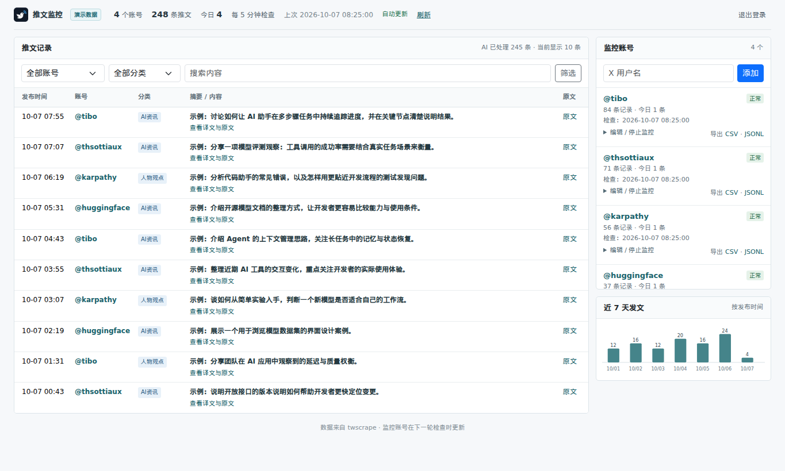
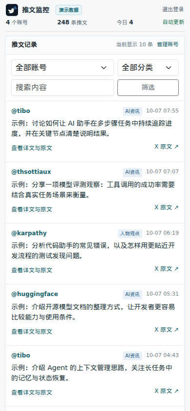

# X 账号监控台

Poll X accounts with `twscrape`. The first successful check for each account saves a baseline; later checks print new posts and append them to a per-account JSONL file. Reposts are excluded. Existing post IDs are loaded from the JSONL files when the process restarts. The Flask dashboard provides account management, search, AI summaries and translations, live updates, and full CSV/JSONL exports.

## 工作流



网页展示已保存的推文；按账号导出完整 CSV 或 JSONL。

## 页面示意

以下截图以 @tibo、@thsottiaux 等 AI 领域账号名展示虚构演示推文。

### 桌面



### 手机



## Setup

```bash
cd /srv
git clone https://github.com/mmQuo/x-monitor.git x-monitor
cd /srv/x-monitor
python3 -m venv .venv
.venv/bin/pip install -r requirements.txt
cp config/targets.example.txt config/targets.txt
```

Add cookies from an X account you control. Run this locally; do not paste cookies into a chat. The cookies must include `auth_token` and `ct0`:

```bash
.venv/bin/twscrape --db accounts.db add_cookie my_account
chmod 600 accounts.db
.venv/bin/twscrape --db accounts.db accounts
```

## Run

```bash
TWS_TELEMETRY=0 .venv/bin/python monitor.py --targets-file config/targets.txt --once
TWS_TELEMETRY=0 .venv/bin/python monitor.py --targets-file config/targets.txt --interval 300
```

Add one username per line to `config/targets.txt`, without needing to restart the service. `@` is optional. For example, `tibo` uses `tibo_posts.jsonl`. You can also run a one-time check with repeated flags, such as `--username tibo --username thsottiaux --once`. Use `--output-dir` to choose the directory for account JSONL files.

Each JSONL record includes the post ID, URL, creation time, observation time, text, and a `baseline` flag. The first check fetches up to 100 recent posts from the account timeline; later checks search the latest 20 posts from that account to use a separate rate-limit bucket. Keep `accounts.db` private because it contains session cookies. To start a fresh baseline for an account, move or remove its JSONL file before restarting.

New records also save X's short URL and expanded URL from tweet entities. Historical `t.co` links are cached in `link_data/links.json`; `x-monitor-links.timer` resolves newly found links every 10 minutes, or run `.venv/bin/python link_backfill.py` manually. The backfill requests `t.co` only and reads its redirect target without following the destination. The dashboard links to the expanded URL and falls back to the original `t.co` URL if expansion fails. AI sees expanded URLs but does not treat a destination URL as evidence of the linked page's contents.

The deployment units are in `deploy/systemd/`. They assume this directory is `/srv/x-monitor` and use separate `xmonitorweb` and `xmonitorai` service users. Adjust paths and permissions for another host. The monitor checks every 300 seconds; inspect it with `systemctl status x-monitor-monitor.service` or `journalctl -u x-monitor-monitor.service -f`.

## Web dashboard

The password protected dashboard runs as `x-monitor-web.service` on `127.0.0.1:8765`. Put an HTTPS reverse proxy in front of it; secure cookies require HTTPS. It manages monitored usernames through `config/targets.txt` and displays saved posts and per-account check status. Adding, editing or removing a username takes effect on the next polling cycle. Removing an account leaves its historical JSONL file intact.

The application service stays bound to localhost. Check it with `systemctl status x-monitor-web.service`. Set `XMONITOR_WEB_SECRET`, `XMONITOR_WEB_USERNAME`, and `XMONITOR_WEB_PASSWORD_HASH` in `/etc/x-monitor-web.env`; generate the hash with `werkzeug.security.generate_password_hash`. Set `XMONITOR_AI_BASE_URL`, `XMONITOR_AI_API_KEY`, and optionally `XMONITOR_AI_MODEL` in `/etc/x-monitor-ai.env`. Keep both environment files outside the repository and readable only by the relevant service users.

The web backend uses Flask. The dashboard uses a locally vendored Bootstrap 5 stylesheet, with a small set of layout rules in `static/style.css`.

Each monitored account has CSV and JSONL download links in the account list. Exports include every post saved in that account's JSONL file. CSV includes the original text, tweet URL, timestamps, AI category, summary, translation, and expanded links when available. JSONL downloads the original stored records unchanged.

The authenticated `/events` SSE stream watches saved posts, AI annotations, status, and link cache files. When one changes, the page refreshes the visible feed without navigating away; the X checks themselves still run every 300 seconds.

## Repository contents

The repository contains source code, templates, static assets, a sample account list, dependencies, and deployment units. Session cookies (`accounts.db`), environment files, actual account lists, saved posts, AI annotations, link caches, and runtime status are excluded by `.gitignore`.
