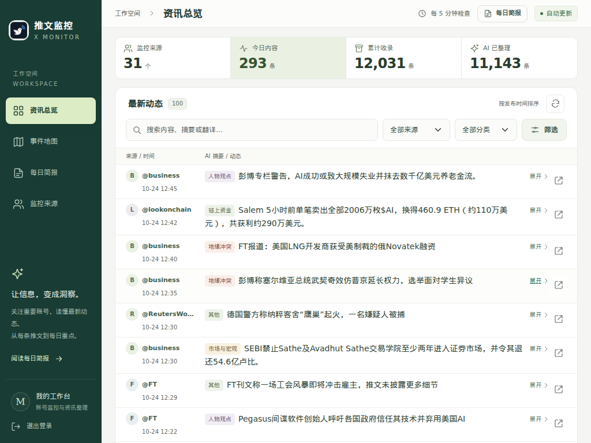
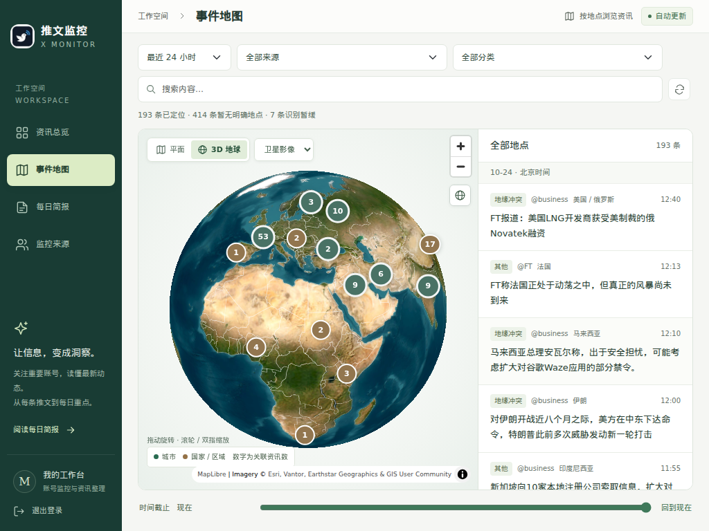
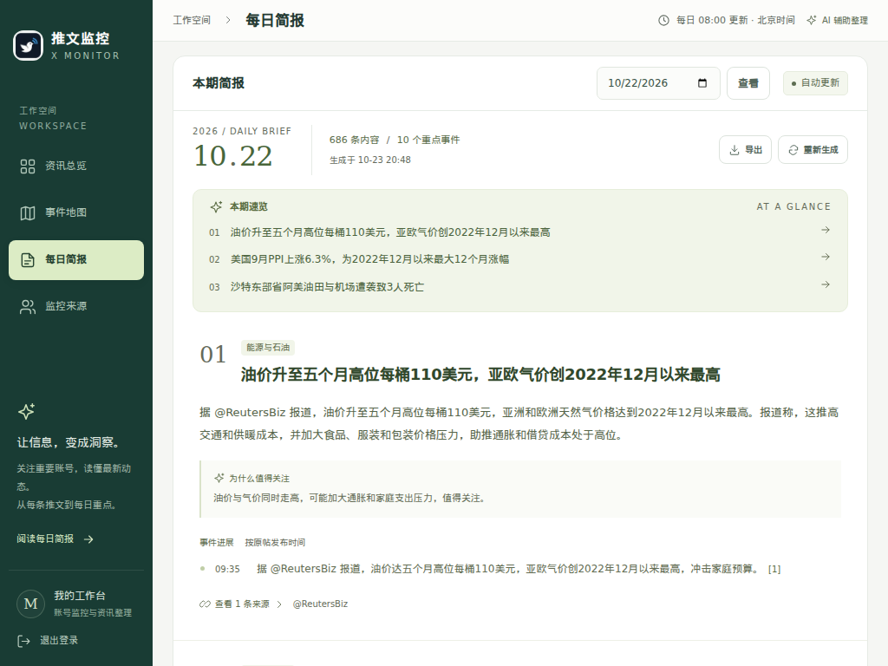

# X Monitor · 推文监控台

一个聚合 X 账号动态与 RSS 订阅的中文资讯工作台，覆盖 **AI、Web3、宏观经济与地缘政治**。从实时动态到每日简报，把关注的信息集中起来，方便浏览、筛选和回顾。

## 核心功能

- **事件地图**：默认 3D 卫星地球，可切换平面视图和彩色底图，按时间、来源和分类浏览资讯，点击地点查看相关内容与原文依据。
- **新闻订阅**：接入华尔街日报市场新闻、美联储货币政策与官员讲话，每 5 分钟更新，支持中文整理和日报汇总。
- **账号追踪**：定时采集关注账号的动态，集中管理信息来源。
- **中文阅读**：AI 摘要、完整翻译、主题分类，支持账号与关键词筛选。
- **多主题关注**：AI 产品、链上资金、项目进展、CPI、央行利率、地缘冲突与能源市场。
- **每日简报**：汇总重点事件，呈现进展时间线与原帖来源。
- **历史回顾**：浏览往期简报，导出 CSV、JSONL 和 Markdown。

## 页面预览

### 资讯总览

### 事件地图

### 每日简报

部署与运行见 [部署指南](docs/deployment.md)。
