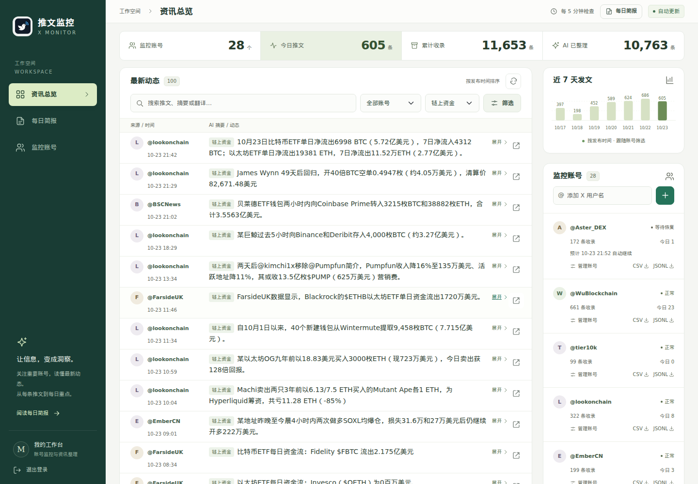
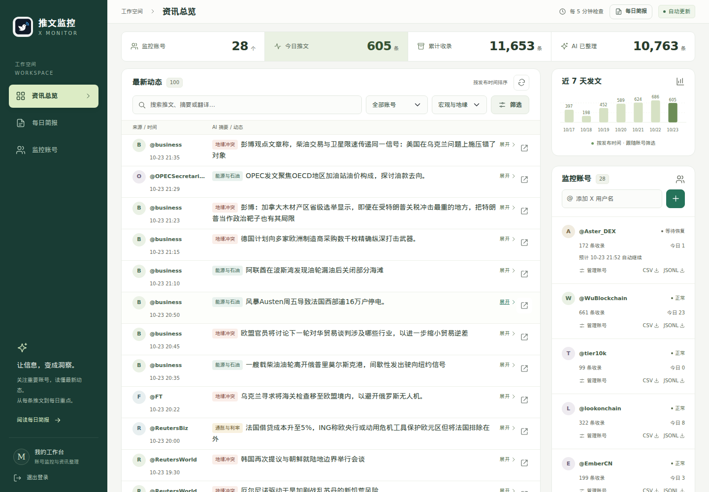
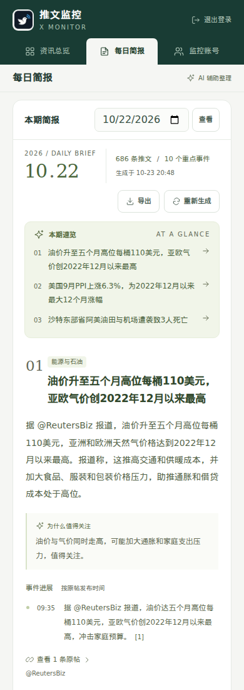

# X Monitor · 推文监控台

把关注的 X 账号整理成一个中文资讯工作台：定时采集原帖，生成摘要、翻译与分类，再将一天的内容汇总为带来源的每日简报。适合同时跟踪 **AI、Web3、宏观与地缘政治**。

基于 Python、Flask / Jinja、twscrape 和兼容 Chat Completions 的模型接口。数据保存在本地 JSONL 与 SQLite，前端使用原生 JavaScript 和本地 Bootstrap 样式，无需前端构建服务。

## 页面预览

以下为 **2026-10-23 从实际保存的数据渲染的页面**，包含公开 X 帖子及已有 AI 整理结果。日报展示 2026-10-22 的存档；截图反映当时的应用内容，不代表实时行情或独立核验的新闻。截图方式与全部图片见 [截图说明](docs/screenshots.md)。

### 资讯总览

紧凑的顶部统计、两行摘要和可展开原文，让首屏直接用于阅读动态。右侧提供发文趋势与账号管理。


### Web3 动态

通过「链上资金」筛选查看转账、持仓及资金流向，也支持上币与产品、项目动态和安全预警等分类。



### 宏观与地缘

「宏观与地缘」聚合通胀与利率、地缘冲突、能源与石油，也可分别筛选 CPI、央行政策、冲突进展及油气新闻。



### 每日简报

按事件阅读重点、进展时间线及原帖来源，支持历史查看、继续重试和 Markdown 导出。


<details>
<summary>查看手机端</summary>




</details>

## 功能

| 能力 | 行为 |
| --- | --- |
| 账号采集 | 默认每 5 分钟检查；首次保存最多 100 条基线，后续检查最新 20 条；排除转推，保留回复、引用及附件标记 |
| 额度恢复 | 接口限流时显示预计恢复时间，等待后继续当前及剩余账号；登录失效单独显示异常 |
| 阅读与筛选 | 中文摘要、完整翻译、原帖展开；账号 / 分类 / 关键词组合筛选；SSE 自动更新 |
| 宏观分类 | CPI、PCE、PPI、就业与央行政策；地缘冲突；原油、天然气、EIA 与 OPEC 动态 |
| 原文与链接 | 原始 JSONL 留存、短链展开缓存、按账号导出完整 CSV / JSONL |
| 预清洗 | 整理文本与链接，标记重复及上下文风险；保留原始证据，不单凭标签丢弃内容 |
| 每日简报 | 北京时间 08:00 汇总前一天；最多 10 个重点事件；任务持久化、断点恢复、来源引用、Markdown 导出 |
| 界面与管理 | 桌面和手机布局、登录保护、账号增删改；移除监控账号后保留历史文件 |

账号可在页面维护，也可直接修改 `config/targets.txt`，下一轮采集生效。`config/targets.example.txt` 提供 AI、Web3 和宏观来源示例；按需启用，不包含部署实例的完整账号列表。

## 开始使用

需要 Python 3.10+，Linux / Unix 环境，以及可用的 X 会话。完整网页部署、服务权限和模型配置见 [部署指南](docs/deployment.md)。

```bash
git clone https://github.com/mmQuo/x-monitor.git
cd x-monitor
python3 -m venv .venv
.venv/bin/pip install -r requirements.txt
cp config/targets.example.txt config/targets.txt
```

在自己的终端中导入 X 账号 Cookie，包含 `auth_token` 与 `ct0`：

```bash
.venv/bin/twscrape --db accounts.db add_cookie my_account
chmod 600 accounts.db
.venv/bin/twscrape --db accounts.db accounts
TWS_TELEMETRY=0 .venv/bin/python monitor.py --targets-file config/targets.txt --once
```

持续采集：

```bash
TWS_TELEMETRY=0 .venv/bin/python monitor.py --targets-file config/targets.txt --interval 300
```

采集可独立运行；启用中文整理和日报时，再配置 `XMONITOR_AI_BASE_URL`、`XMONITOR_AI_API_KEY` 与 `XMONITOR_AI_MODEL`。

## 文档与目录

- [部署指南](docs/deployment.md)：环境变量、systemd、权限、反向代理及常用运维命令。
- [架构与数据流](docs/architecture.md)：模块职责、分类、清洗缓存和日报流程。
- [截图说明](docs/screenshots.md)：真实数据来源、页面尺寸及重新渲染命令。

```text
monitor.py                  X 账号采集与增量保存
ai_worker.py / categories.py 中文摘要、翻译与共享分类
link_*.py                   短链缓存与正文链接处理
clean_*.py / post_cleaner.py 文本预处理与清洗缓存
daily_worker.py             每日简报生成流程
report_store.py              日报队列、快照与断点存储
web_app.py / report_web.py   登录、工作台、导出与日报路由
templates/ / static/        页面、样式、图标和交互
deploy/                     环境变量示例与 systemd 单元
scripts/                    页面截图工具
tests/                      清洗、分类和日报回归测试
```

## 开发与验证

```bash
.venv/bin/python -m unittest discover -s tests -v
```

测试使用临时数据和模拟模型响应，不需要 X Cookie 或模型 API Key。页面截图额外使用 Playwright，安装方式见 [截图说明](docs/screenshots.md)。

仓库只保存源码、示例配置、文档和页面图片。`.gitignore` 排除了会话数据库、环境变量文件、实际账号列表、原始推文、AI 注解、短链缓存、清洗缓存、日报数据库与运行状态。
