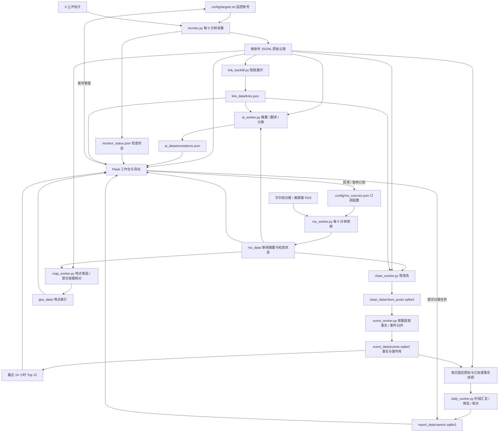

# 架构与数据流

应用由独立 Python 进程和一个 Flask 网页组成，共享本地文件。网页直接读取已保存内容，采集、中文整理、预清洗和日报任务由后台进程完成。

## 采集与阅读

`monitor.py` 每轮重新加载目标账号。首次从时间线保存最多 100 条基线，后续从搜索接口检查最新 20 条，以帖子 ID 与首次检查时间判断增量。进程重启后从 JSONL 恢复已有 ID。每次增量检查的覆盖范围为账号最新的 20 条内容。

共享登录会话达到接口额度时，采集进程读取本地会话池的恢复时间，等待后继续当前账号及本轮剩余账号。网页显示「等待恢复」和预计时间，保留上次检查结果；等待期间每 30 秒检查本地状态，可识别新增会话及已移除的目标账号。较长冷却结束、本轮完成后再等 5 分钟开始下一轮。登录失效单独显示异常；`--once` 将接口错误直接返回终端。

采集账号自身发布的帖子，记录 ID、URL、发布时间、观察时间、文本、基线标志、短链映射及媒体 / 回复 / 引用标记。各账号保存为小写文件名，如 `lookonchain_posts.jsonl`。

`ai_worker.py` 生成中文摘要、分类和完整翻译。首次运行整理当时最新的 100 条，新采集的帖子继续处理；结果按帖子 ID 缓存。新的分类规则用于后续处理，已有注解沿用缓存。

`web_app.py` 提供登录、CSRF 检查、账号管理、筛选和导出。页面展示最多 100 条最近的匹配记录，单账号参与筛选的候选范围为文件末尾 300 条；完整历史通过账号导出获取。摘要默认压缩为两行，展开后可读翻译与原文。SSE 检测本地文件变动，刷新动态时保留已展开的记录。

`link_backfill.py` 读取 `t.co` 的重定向目标，将展开后的地址缓存并用于原帖链接和 AI 处理。展开失败时使用原短链。

`rss_worker.py` 独立读取华尔街日报市场新闻、美联储货币政策公告与官员讲话。首次保存北京时间今天和昨天的标题及摘要，之后每 5 分钟检查，支持条件请求与失败退避。文章 URL 生成带 `rss:` 前缀的独立 ID；中文整理、筛选、预清洗、日报与导出共用这些记录，引用保留媒体名称和原文 URL。暂停订阅后，已保存内容仍可查看和导出。

## 分类

`categories.py` 同时供 AI、网页筛选和日报使用，统一维护分类与宏观规则。

| 分类 | 范围 |
| --- | --- |
| AI资讯 | 模型、智能体、API、AI 产品与开发工具 |
| 财经新闻 / 公司与产品 | 企业财报、商业交易，以及其他领域的产品与服务；保留已有分类兼容性 |
| 上币与产品 / 链上资金 / 项目动态 | 加密资产上新、链上转账与持仓、项目进展 |
| 通胀与利率 | CPI、PCE、PPI、就业、GDP、央行决议、利率及资产负债表 |
| 地缘冲突 | 军事行动、停火、外交冲突、制裁与贸易摩擦 |
| 能源与石油 | 原油、天然气、库存、产量、OPEC 政策及能源设施 |
| 市场与宏观 / 安全预警 / 人物观点 / 活动与社区 / 其他 | 一般行情、风险、评论、活动及其他内容 |

「宏观与地缘」是三类宏观主题的聚合筛选项，模型输出具体子类。经济数据规则区分实际值 / 预期值 / 前值、同比 / 环比、百分比 / 基点；预测与评论仍按主题分类，摘要注明观点来源和预测性质。

## 预清洗

`clean_worker.py` 每 30 秒处理北京时间今天、昨天的内容。规则整理 HTML 转义、空白与短链，保留数字、否定词、版本号、署名及代码缩进；完整链接单独保存，匹配时忽略明确的跟踪参数。

缓存使用原始内容、相关链接映射及清洗规则版本校验。问候、推广、链接和上下文等标签辅助事件提取，正文提供判断依据。同文帖子组成重复组，带有附件或引用以及待补充上下文的记录分别保存。

## 每日简报

1. 每天北京时间 08:00 为前一天入队，也可在页面指定日期生成。服务在 08:00 后启动会补上前一天任务。
2. 读取当期监控来源、当日原帖及已保存的事实。后台尚未处理完的内容进入等待状态，30 秒后再检查；就绪后固定快照。
3. 按事件归并指定时段的事实并选取重点，再用来源原文节选核对标题、摘要、数字与署名。上午和下午生成的不同期数复用单帖事实，分别汇总该期范围内的进展。
4. 所有输入完成处理且引用校验通过后发布，最多保留 10 个重点事件，提供原帖时间线和 Markdown 导出。

单次提示最多 24,000 UTF-8 字节，分批材料最多 15,500 字节，同阶段最多两个批次并行。长帖分段处理，中间结果和用量写入 SQLite。任务在后台持续处理；失败后「继续重试」复用已完成步骤和同一期快照。新一期生成失败时，旧的完成版本仍可查看。

提取、筛选和核对时，程序将来源映射为本次请求内的短编号（如 `S1`、`S2`），校验后还原为原帖或 RSS ID，保存完整来源和分段信息。引用校验失败时，重试会附带校验反馈和允许的编号；提取批次连续失败则拆小处理，并保存已完成的子批次。

完整提示词在 [`report_prompts.py`](../report_prompts.py)。三个阶段共用影响范围、后果程度、新增信息和时效价值四项评估标准，各主题共用候选名额；证据确定性通过来源归属和状态表达。提取阶段建立候选，筛选阶段比较事件，核对阶段用原文逐项验证事实、归属及时间关系。

## 持续处理与实时 Top 10

`event_worker.py` 独立扫描清洗结果，每轮处理后等待 15 秒；与原有翻译 / 分类进程一起持续处理新内容。初始化范围为北京时间今天和昨天。完整提示词在 [`event_prompts.py`](../event_prompts.py)。

1. **单帖事实**：按原文、相关短链、清洗版本、提取提示词及模型保存版本。长帖分段，单次最多 10 段、15,500 UTF-8 字节，同阶段最多两批并行。每项事实只引用自身输入，并保存通过逐字校验的原文摘录。
2. **事件归并**：用具体主体和中英文关键词召回已有事件，再由模型判断同一事件及其进展。保存全部事实的事件归属。候选召回覆盖最近 7 天，跨语言别名或含糊表达仍可能造成漏合并。
3. **事件更新**：只汇总受影响的事件，使用新事实及已有摘要对应的原文。原帖修改或处理版本变化时重建受影响摘要；失效依据在重建完成前退出实时展示。已完成日报保留自己的快照。
4. **实时排名**：`/top` 展示最近 24 小时出现实质进展的最多 10 个事件。同一事件的多篇报道合并展示，排名使用 `importance × (0.7 + 0.3 × exp(-进展距今小时数 / 12))`。重要性使用统一的 1–5 分尺度；重复报道数量不计入排名，重复原文不刷新进展时间。
5. **自动更新**：SSE 通知页面读取最新结果，并按分钟检查时间衰减与过期；15 秒轮询补充断线恢复。来源与进展展开状态随事件 ID 保留。

事实、归并和摘要阶段都有独立持久化结果与重试退避。重启复用已处理内容。日报只消费这些保存结果；旧版本未完成任务仍按其已冻结快照恢复。较早日期若缺少事实处理结果，页面会给出明确状态，已有历史日报继续保留。

采集仍按每 5 分钟一轮执行，实时页面在采集、后台处理完成后更新；首次整理的进度显示在列表上方。

## 数据存储

| 位置 | 内容 | 写入方 |
| --- | --- | --- |
| `config/targets.txt` | 当前目标账号 | 网页 / 管理员 |
| `config/rss_sources.json` | 已启用的 RSS 来源 | 网页 / 管理员 |
| `rss_data/` | RSS 标题、摘要与检查状态 | RSS 进程 |
| `accounts.db` | twscrape 会话 Cookie | twscrape / 采集进程 |
| `*_posts.jsonl`、`*.baseline_at` | 原始帖子与首次检查时间 | 采集进程 |
| `monitor_status.json` | 检查时间、数量、错误状态 | 采集进程 |
| `geo_data/` | 近 7 天地点、原文依据与识别进度 | 地图进程 |
| `ai_data/` | 中文注解、初始化状态 | AI 进程 |
| `link_data/` | 短链展开缓存 | 短链进程 |
| `clean_data/` | 预处理结果与文件版本 | 预清洗进程 |
| `event_data/` | 版本化单帖事实、事件归属、当前事件摘要、模型步骤与用量 | 事件进程 |
| `report_data/` | 队列、各期快照、步骤、用量与结果 | 网页 / 日报进程 |

备份正在使用的 SQLite 时使用 SQLite backup API，完整保存主文件与 WAL 中的数据。
